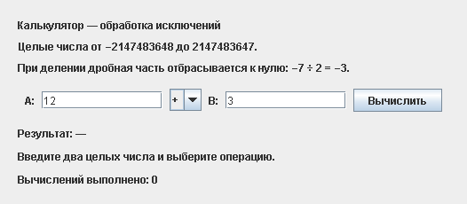

# Лабораторная работа № 5

## Демонстрация работы

Успешное вычисление, обработка деления на ноль, неверного ввода и переполнения. После исправления ошибки калькулятор продолжает работу без перезапуска.

## Обработка исключений

| Ситуация | Исключение | Пример |
| --- | --- | --- |
| Пустое поле, текст, дробь или число вне диапазона int | `NumberFormatException` | `abc`, `1.5`, `2147483648` |
| Деление на ноль | `ArithmeticException` | `12 ÷ 0` |
| Переполнение результата | `ArithmeticException` | `2147483647 + 1`, `−2147483648 ÷ −1` |

 Для деления проверки явно выбрасывают исключение через `throw`. Контроллер обрабатывает ошибки в `try-catch`, начиная с `NumberFormatException` перед родительским `IllegalArgumentException`. Блок `finally` обновляет счётчик всех попыток независимо от результата.

 Деление отбрасывает дробную часть к нулю: `7 ÷ 2 = 3`, `-7 ÷ 2 = -3`.

## Структура

- `src/CalculatorModel.java` — вычисления и исключения.
- `src/CalculatorView.java` — окно ввода и вывода.
- `src/CalculatorController.java` — события, `try-catch-finally`.
- `src/Main.java` — запуск интерфейса в потоке Swing EDT.
- `tests/CalculatorTest.java` — проверка вычислений, ошибок и восстановления после ошибки.

